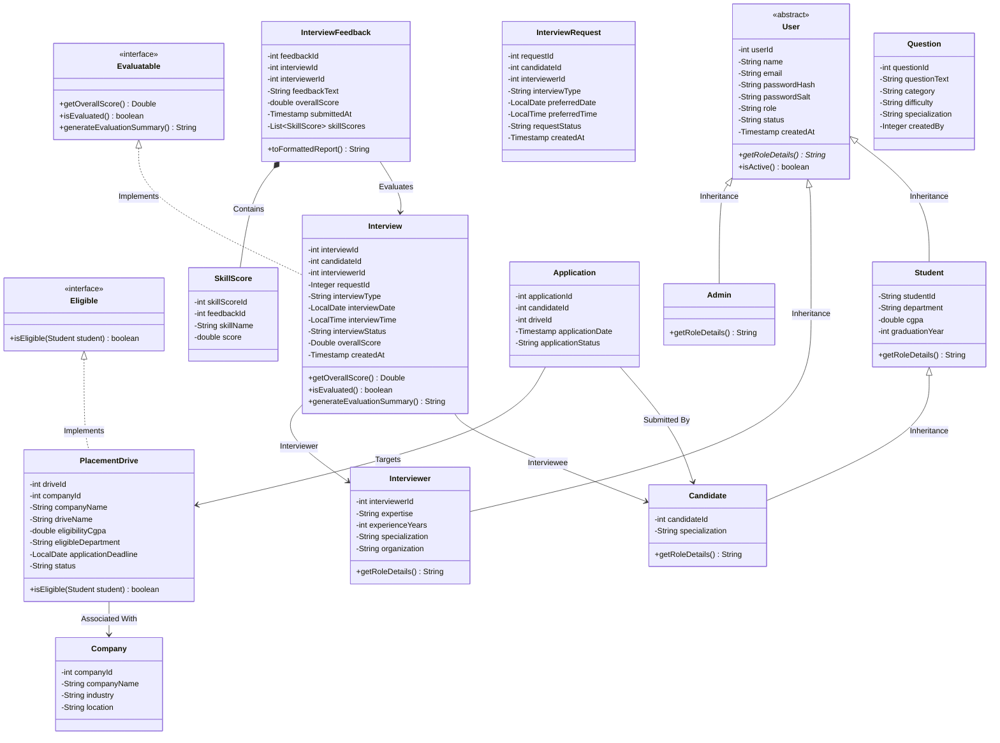

# Class Architecture & Object-Oriented Design

## 1. Class Hierarchy Diagram (Mermaid)

---

## 2. Object-Oriented Design Rationale

### A. Encapsulation
Every model class hides its internal fields using the `private` access modifier. Access to and modification of state is strictly governed by public getters and setters equipped with validation where appropriate.

### B. Meaningful Inheritance
The hierarchy follows real-world domain relationships:
- `User`: Encapsulates system identity, credentials, role, and active status.
- `Student`: Extends `User` to add academic attributes (`studentId`, `department`, `cgpa`, `graduationYear`).
- `Candidate`: Extends `Student` to represent an active participant in mock interviews, carrying interview specialization while inheriting academic eligibility.
- `Interviewer` and `Admin`: Extend `User` directly, preserving modular role attributes.

### C. Polymorphism & Abstraction
The abstract method `getRoleDetails()` in `User` is polymorphically overridden in `Student`, `Candidate`, `Interviewer`, and `Admin` to provide tailored profile descriptions depending on the concrete instance at runtime.

### D. Interfaces
- **`Eligible`**: Encapsulates the contract for evaluating candidate criteria against placement drive rules. `PlacementDrive` implements `isEligible(Student student)` to verify whether a student's CGPA and department satisfy minimum requirements.
- **`Evaluatable`**: Decouples evaluation reporting from concrete classes. `Interview` implements `Evaluatable` to provide uniform access to scores and report generation.
