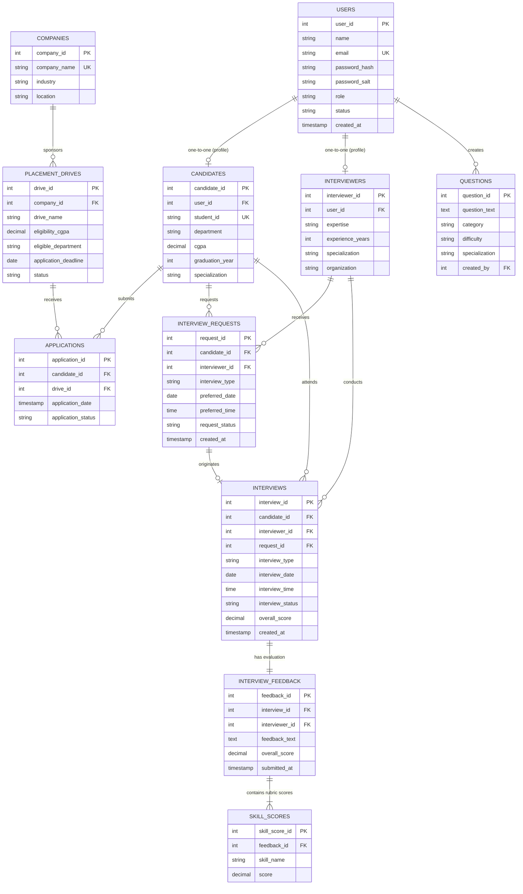

# Database Architecture & Relational Design

## 1. Entity-Relationship Diagram (Mermaid)

---

## 2. Relational Schema Details & Normalization

The database adheres strictly to **Third Normal Form (3NF)**:
1. **1NF**: Every column contains atomic values, each table has a primary key, and repeating groups are eliminated.
2. **2NF**: All non-key attributes are fully functionally dependent on the entire primary key.
3. **3NF**: There are no transitive dependencies; non-key attributes depend only on the primary key.

### Key Constraints & Integrity Rules
- **Unique Constraints**:
  - `users(email)` ensures unique user accounts.
  - `candidates(student_id)` and `candidates(user_id)` prevent duplicate student profiles.
  - `applications(candidate_id, drive_id)` prevents redundant applications to the same drive.
  - `interviews(request_id)` ensures a one-to-one link from a request to an interview.
- **Check Constraints**:
  - `cgpa >= 0.00 AND cgpa <= 10.00`
  - `overall_score >= 0.00 AND overall_score <= 100.00`
  - `score >= 0.00 AND score <= 100.00` on individual skill rubrics.
- **Foreign Keys**:
  - Cascade deletes on user profiles ensure orphaned records are not left behind.
  - Set null rules on audit fields (e.g. `questions.created_by`) ensure content remains if an admin is deleted.

---

## 3. Database Transactions (ACID Compliance)
In `FeedbackDAO.submitEvaluationTransaction()`:
1. `conn.setAutoCommit(false)` initiates an atomic transaction block.
2. Step A: Insert `interview_feedback` row.
3. Step B: Insert batch of `skill_scores` using PreparedStatement batch execution.
4. Step C: Update `interviews` row with status `COMPLETED` and overall score.
5. `conn.commit()` commits all changes atomically.
6. If any step fails, `conn.rollback()` restores the database state, preventing partial evaluation writes.
